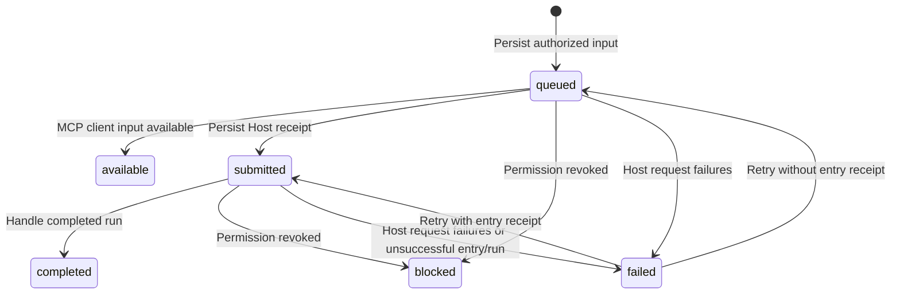

# Routing and delivery

## Conversation routes

A configured route binds a nonempty `sources` list to one Agent Host. Each source
contains `channel_id`, `conversation_kind` (`private`, `group`, `guild`,
`guild_dm`, `channel`, `thread`, or `*`), and
`conversation_id`. `channel_id: "*"` includes current and future channel accounts;
`conversation_id: "*"` matches all conversations of that kind. A source with both
`conversation_kind: "*"` and `conversation_id: "*"` matches all supported
conversation types, including on future accounts selected by `channel_id: "*"`.
A wildcard kind requires a wildcard conversation ID. The console labels this
scope **All conversations** and labels private-only scope **All private chats**.
Existing private-only sources remain private-only until explicitly edited.
Private user IDs
and group IDs are distinct, literal platform identifiers, not linked identities.
Each source selects a conversation, not an individual sender within a group.
The console treats these sources as the complete activation filter. Legacy API
sender policies can further limit activation, but readable channel grants in
Connections are independent of activation and never create source bindings.
Source lists contain at most 100 rows; empty and duplicate lists are rejected.

An `a13n` Host requires an Agent ID; the console selects it from published,
unarchived agents on that Host. A generic `mcp` Host has no upstream agent ID
or dedicated a13n MCP binding. Sources, readable channels, name, Host, Agent, and reply policy
can be edited through management. Host/Agent and execution-policy changes are
refused while an input is queued or submitted. The
[authorization contract](02-identity-and-access.md) owns sender and tool authority.

Selection prefers a specific user/group over all conversations, then a specific
channel over all channels, then a specific conversation kind over all kinds.
Equal-specificity overlaps between configured routes
are rejected atomically, including disabled routes. A disabled or sender-denying
specific rule never falls back to a broader rule. Each account/kind/conversation
has at most one live concrete binding and cannot fan out to multiple Agents.

Source-list configurations have concrete child bindings for each matched account
and conversation. Children keep separate source identities and inherit current access and
reply policy. A source removal, more-specific replacement, or Host/Agent change
archives obsolete children, blocks their pending inputs/replies, and removes
their private reply contexts. History stays available to administrators but is
not inherited by replacement MCP bindings. No old inputs are replayed.

The legacy single-source API and stored routes remain readable and editable.
Opening or saving an unchanged source does not rewrite a legacy binding. When a
legacy exact route is expanded, its configuration ID and token remain stable;
its thread and history move atomically to a concrete child if that source and
Agent still apply. Other children start fresh. Existing sender restrictions are
preserved rather than broadened during conversion.

For an `a13n` Host, `thread_policy` chooses delivery context:

| Policy | Thread scope |
| --- | --- |
| `conversation` (default) | One thread for each concrete channel account/kind/conversation |
| `sender` | One thread per verified sender within each concrete conversation; the same sender in another group or account is independent |
| `fixed` | All sources of the configured route share one thread; select `fixed_thread_id` or create it on the first submitted message |
| `message` | Each incoming message creates a fresh thread and session |

An existing fixed thread must be accessible and unarchived on the selected Host
when saved. The console offers existing threads and an explicit create-on-first-message
choice. `fixed_thread_id` is rejected for other policies; generic MCP Hosts accept
only the default policy and no fixed thread. Existing stored routes keep
`conversation` semantics and their existing binding until explicitly changed.
Fixed threads intentionally share upstream history across sources; removing a
source cannot retract history already submitted to that thread.

Thread bindings persist across restarts. Before an external request, an event
freezes its binding scope, target and body; retries reuse that exact request and
idempotency key, including for `message`. Only the oldest unconfirmed submission
in a destination scope advances. Accepted inputs are polled independently;
the busy-input policy below controls whether they delay new submissions.
Independent sender or per-message threads do not block each other. Fixed delivery
shares its scope across all sources, including other routes explicitly targeting
the same Host/thread. Tool calls explicitly select their authorized source route.
Changes to thread policy or fixed destination are refused during queued/submitted
work, and obsolete children are archived so the next input starts under the new
thread policy. Per-event thread IDs identify the actual delivered thread rather
than a conversation's last thread. This remains single-process scheduling, not a
distributed worker protocol.

Administrator-only `POST /api/v1/routes/{id}/reset-thread` detaches the current
thread bindings of one concrete a13n conversation. Conversation policy resets
that conversation's thread; sender policy resets all sender threads within it.
The operation is atomic and returns 409 while any input for that conversation is
queued or submitted. The next new input creates a fresh thread and session.
Route identity, credentials, access, other conversations, channel message history,
and upstream threads remain unchanged. No historical input is replayed. Failed
historical requests retain their frozen destination when explicitly retried but
cannot restore a detached binding. Resetting before the first message is harmless.
The console exposes **Reset conversation** with confirmation in Messages'
conversation details. Parent wildcard routes and generic MCP routes are rejected;
fixed-thread routes require choosing a new shared destination in route settings,
and per-message routes already start fresh for every input.

## Messages during execution

`busy_policy` is independent of `thread_policy` and applies to a13n Hosts:

| Policy | Submission behavior |
| --- | --- |
| `steer` (default) | Submit new input immediately with a13n `delivery: steer`; compatible input joins the active run at its next safe boundary |
| `queue` | Keep new input queued until earlier submitted work in the destination thread finishes, then submit FIFO with `delivery: next_run` |

A steer continues the current run; it does not call the interrupt/cancel API.
The Host owns safe-boundary incorporation, compatibility and waiting/resume
semantics. An idle thread starts a run for either policy. A fresh per-message
thread is independent; queue mode does not impose a global account or Host queue.
Generic MCP Hosts expose no execution control and reject non-default busy policy.

Missing stored policies default to `steer`. Children inherit the current parent's
policy. The policy may change during execution without changing thread identity
or resetting bindings. A change affects only requests whose bodies are not yet
frozen. Previously frozen bodies retain their delivery selection on every retry;
a lost acceptance receipt still blocks later submissions in that scope until
resolved. Each cycle reserves capacity for polling accepted work as well as
admitting new requests.

Several steers may be assigned to one native run. Each input tracks its exact inbox
entry and assigned run independently. A completed run completes its accepted inputs;
CG never reads, validates, serializes, forwards or retries the run's final output.
An Agent sends channel messages only through the authorized MCP message tools,
using an explicit concrete `route_id`. No tool call means no channel message.
A final text, empty value, object or legacy reply envelope has no delivery effect.
Every newly prepared Host input includes a `channel_output` context declaring
`send_message` as its output tool and final output as private. Already frozen
requests retain their original bodies.

Administrator-only `GET /api/v1/connections/{id}/host-resources/{resource}` supports
`agents` and `threads` for a configured a13n Host. It uses that Host's server-side
credential, forwards a bounded opaque `cursor` with a page size of 50, and returns
only `{items: [{id, name}], next_cursor}`. Archived resources and unpublished
agents are omitted. Failure returns a safe diagnostic without upstream bodies or
credentials. The browser can search loaded choices and request later pages.

Administrator-only `DELETE /api/v1/routes/{id}` removes an active route and any
concrete children of an all-conversation parent. One transaction blocks pending
inputs and queued replies, clears their private incoming reply contexts, archives
the source identity, policy and thread binding without token hashes, and releases
the account/conversation uniqueness constraint. Removed route tokens no longer
authorize MCP. Historical received messages, observations, replies, and receipts
remain readable through administrator conversation history. Recreating the same
source creates a new route identity and thread binding; it does not replay old
inputs or restore an archived token. In-flight external requests or Agent runs
cannot be retracted. Creating routes or children and updating bindings recheck
resource existence in their storage transaction so deletion cannot be undone by
a stale configuration write.

## All-conversation routes and identity discovery

`conversation_id: "*"` creates an all-conversation route for one channel account
and conversation kind. A specific route takes priority, even when disabled or
its sender policy denies the input; denial never falls back to a broader route.
When an authorized new conversation matches `*`, CG persists a concrete child
route with `parent_route_id`. Each child retains its source identity; the thread
policy above determines its thread and input queue.
Its enabled state and sender, permission, reply policies are rechecked against
its parent at every authorization boundary. Parent edits apply to existing
children; child access cannot be independently edited. The console lists parent
configuration; management API views also expose concrete children and bindings.
The source tuple remains unique and cannot fan out.
MCP listing also materializes authorized previously observed conversations under
an enabled `*` route, without queuing old inputs or creating upstream threads.
Existing exact routes take priority even when disabled or assigned to another
Host; history discovery cannot override that assignment.

Multi-source and wildcard a13n routes use the shared Host MCP connection and
explicit concrete route IDs. A dedicated route MCP binding remains optional and
is supported only for one concrete source. Existing exact routes retain their
bindings and legacy sender allowlists. Tool selection always follows the Agent
configuration; a dedicated binding is never required for Host-key tool sends.

Verified supported messages without a route appear in management as `unmatched`,
with nullable `route_id`. Denied ingress appears as `blocked`, also without a
route binding. Both are durable administrator observations, deduplicated by the
same account/conversation/source-message identity as delivered inputs. They
never enter the worker queue. MCP can read their text after the source
conversation and sender are authorized by its current route. Adding a route or
provider redelivery does not replay them as Agent work. A new message is required
to trigger execution after configuration.
Earlier messages discarded by older versions cannot be recovered from local
state. Pairing credentials and reply-context tokens are never included in these
observations.

Channel collection precedes routing: every bounded authenticated packet is
retained under the [channel-event journal contract](01-channel-adapters.md#route-independent-event-retention),
including events that cannot be projected to a supported message. Route
selection controls Agent delivery and capability access, never packet retention.

## Input lifecycle

| Durable state | Meaning                                                                                   |
| ------------- | ----------------------------------------------------------------------------------------- |
| `queued`      | Authorized input is persisted; Host acceptance is not confirmed                           |
| `available`   | Input is locally available to an MCP client; no Host receipt or run completion is implied |
| `submitted`   | a13n accepted the input; its run may still be queued, running, or waiting                 |
| `completed`   | The assigned run completed and its output was handled                                     |
| `blocked`     | Current route/source authorization prevents further processing                            |
| `failed`      | Host operations exhausted the failure limit, or entry/run processing ended unsuccessfully |

Before the first submission attempt, CG persists the target path and complete
request body. Creation uses `POST /threads`; continuation uses
`POST /threads/{thread_id}/inbox`, with `delivery: steer` by default or
`next_run` for queue mode. The event ID is the
stable `Idempotency-Key`. A lost receipt retries the same target, body, and key,
even when configuration or thread observations change later.

A submission receipt records the thread, inbox entry, and optional run ID.
Without a run ID, CG polls that exact entry for assignment, then polls its run.
Host acceptance does not prove execution completion. Accepted, running, and
waiting runs remain `submitted`; waiting work is resolved in a13n.

Host request/parsing failures increment attempts; five failures mark the event
`failed`. Valid run observations reset that failure counter. Administrator retry
resets attempts and resumes submission or polling based on the persisted entry
receipt; it preserves a frozen submission request. Replacement a13n keys must
retain the same upstream principal/workspace for the upstream idempotency scope
to remain valid.

## Tool-only channel output

Only `send_message` creates outgoing channel messages. Run completion never
creates a reply, parses `reply`/`text`, checks final-text size or retries output
validation. Agents may keep ordinary text final results for private execution
records; these never enter channel history. Quiet participation means completing
without a message-tool invocation, not producing a special envelope or an empty
model response. A model/execution failure is still a failed input; CG never treats
partial text as a successful message.

The removed `reply_source` setting is rejected on create/update and removed from
stored route configuration at startup. Already queued event-linked automatic
replies are blocked with `Automatic output delivery retired`; tool-created queued
messages keep their delivery state. Historical sent/failed/unknown records remain
readable. Existing OneBot MCP reaction authority is converted into its explicit
`message.react.onebot` grant, which applies only to OneBot; other routes gain no
reaction authority.

## Generic MCP delivery

A `mcp` Host has no API endpoint or upstream key. Its routes require
no a13n agent/MCP-connection bindings. The worker
reauthorizes each queued event and marks it `available` without external I/O,
thread creation, or run tracking. Subsequent queued events can advance once the
oldest event is available. Reads do not acknowledge, consume, or complete events;
clients choose their own polling and deduplication strategy using source message
identities. Available history is always filtered by current access at tool time.

No MCP notification, background client wakeup, or autonomous client run is
promised. Clients request replies through MCP under the current route authorization rules.
The gateway cannot infer that a client has finished processing a message.

## Reply lifecycle

| Durable state | Meaning                                                                |
| ------------- | ---------------------------------------------------------------------- |
| `queued`      | Text awaits automatic sending after current authorization checks       |
| `sending`     | CG claimed the reply and may have issued the external request          |
| `sent`        | A confirmed channel acceptance receipt is persisted                    |
| `blocked`     | Route or linked-source authorization prevents sending                  |
| `failed`      | QQ explicitly rejected the operation, including an HTTP rate rejection |
| `unknown`     | Delivery may have happened, but CG has no confirmed successful outcome |

Explicit MCP message requests create queued replies for
private, group, guild-channel, and guild-DM conversations. There is no approve/reject API or manual review
step. Agent tool configuration is managed in the Host.
The worker rechecks route/source access, claims a queued reply, and issues one
channel request. Disabling the route or revoking a linked input's sender blocks
pending replies before sending.

OneBot and QQ receipts contain platform message IDs; Weixin acceptance receipts
use CG's client ID because the provider returns no platform message ID. `sent`
does not prove recipient delivery/reading. Offline OneBot sockets and unpaired
Weixin accounts leave replies `queued` until ready. Missing authorized native
reply context becomes `blocked` before any send request; native platform reply
windows still apply. [Channel adapters](01-channel-adapters.md) owns these protocol
constraints and private context handling.

A timeout, malformed/unconfirmed receipt, or interrupted sending request produces
`unknown`; the baseline conservatively does not assume that such an operation is
safe to repeat. On restart, persisted `sending` replies become `unknown`. Unknown
replies are never automatically retransmitted, and no manual resend operation is
defined. Verify the channel before separately deciding whether another message is
necessary.
An explicit QQ rejection (including HTTP 429 or a nonzero native error code)
produces `failed` and is not automatically retried. Local proactive rate limits
leave unattempted requests `queued`, independently of these failure states.

For existing databases, startup converts previously approved replies to `queued`
and retires unreviewed drafts as `blocked` with a diagnostic; old drafts are never
silently sent. Historical rejected, sent, blocked, and unknown records remain
unchanged. Stored `auto_reply` settings are removed without changing sender access
permissions. New route inputs and updates reject that removed
field. The console includes outgoing records in message conversation history, without
reply editing, decisions, or a separate reply page.

Input deduplication and Host idempotency do not imply exactly-once channel replies.
Channel sending provides no external idempotency guarantee in this baseline.
Queued replies, thread binding, and confirmed receipts survive restart without
resending completed work.

## Administrator conversation history

`GET /api/v1/history` requires an administrator session and the exact
`channel_id`, `conversation_kind`, and `conversation_id`. It merges accepted
incoming events, unmatched/blocked observations, and replies for that source
account and concrete conversation. Incoming records have direction `incoming`;
replies have direction `outgoing`. Parent all-conversation routes are not history
destinations: Messages lists concrete conversations separately.

Records expose ID, route ID, text, sender ID for incoming messages, delivery state,
error, creation time, and any thread/run identifiers. They expose no credentials,
private reply contexts, or frozen Host request bodies. Legacy incoming events
without an address use their retained route's source identity. This is an
administrator history API, independent of MCP capabilities. MCP conversation
reads expose the authorized message subset defined by the
[Agent tool contract](04-agent-tools.md), excluding management diagnostics.

History uses persistence creation time and ID for deterministic chronological
ordering. Each request reads the newest 100 records by default, with `limit`
bounded to 1–100, and returns `messages` in ascending order plus `has_more`.
Earlier pages require both `before_created_at` and `before_id` from the oldest
record of the current page; the cursor uses an exclusive comparison. The console
can load earlier messages and refresh the latest page without duplicating entries.
The conversation overview combines recent activity with enabled concrete routes,
so older route histories remain accessible. Conversation history opens only from
Messages; route rows expose one Edit action with token rotation and enable/disable
settings on its dedicated edit page. Failed incoming deliveries retain their administrator
retry action in conversation history.
